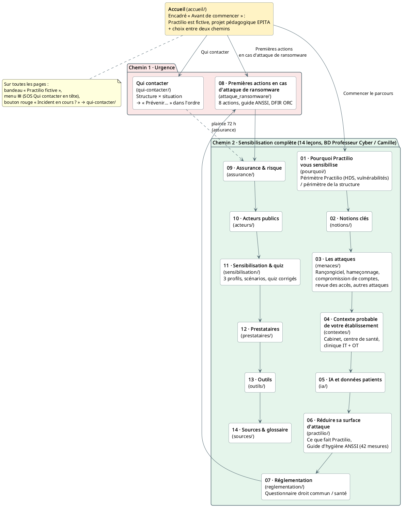
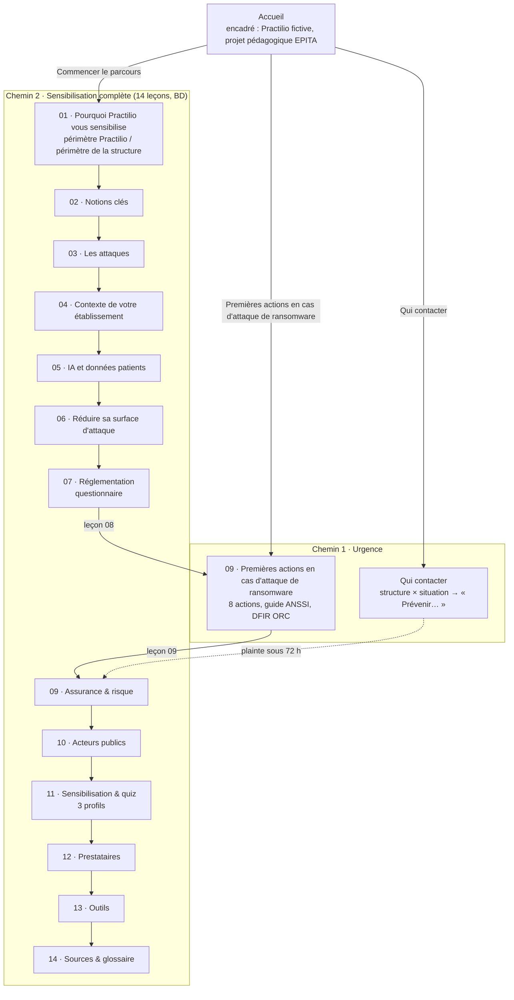

# Parcours utilisateur : Practilio Cyber Repères

Plateforme fictive de sensibilisation et d'orientation cyber (projet pédagogique EPITA, ECSI3-Evaluation-01).
Site publié : https://claude.ai/artifact/7zijhaG621JNWKrSgJ6CEu. Un dossier par thématique : `site/<page>/index.html` + `<page>.js` ; ressources communes dans `site/shared/` (`style.css`, `common.js`, `dialogues.js` généré depuis [dialogues.md](dialogues.md)).

## 1. Ce que fait Practilio (contexte)

| Service | Risque principal côté utilisateurs | Traité dans le site |
|---|---|---|
| Prise de rendez-vous en ligne | Compte usurpé, faux sites imitant la plateforme | Practilio et vous, Menaces |
| Téléconsultation (navigateur ou application mobile) | Application installée hors store, appareil non à jour, lieu non confidentiel | Practilio et vous, scénario IT « fausse application de téléconsultation » |
| Gestion d'agenda | Identifiants partagés, accès conservés après un départ | Scénario secrétariat « tableur des mots de passe » |
| Ordonnances et comptes rendus dans l'Espace Patient | Dépôt dans le mauvais dossier, document piégé envoyé par un faux patient | Fiche secrétariat n° 8 |
| Rappels automatiques (SMS, e-mail, notifications) | Smishing imitant les rappels | Fiche secrétariat n° 7, quiz secrétariat, encadré patients |

## 2. Profils Practilio et espaces du site

| Profil Practilio | Droits dans Practilio | Espace de sensibilisation | Réponse « Votre rôle » sur l'accueil |
|---|---|---|---|
| Praticien | Son agenda ; consultation et enrichissement du dossier médical de son établissement | Praticiens & direction | Praticien, gérant·e, direction |
| Secrétaire médicale | Agendas de l'établissement | Secrétariat & accueil | Secrétaire médicale, accueil, assistant·e |
| Administrateur technique de l'établissement | Gestion des comptes, **sans accès aux données médicales** | Administrateurs & IT | Administrateur technique, référent ou prestataire informatique, DSI |
| Patient | Son dossier, ses rendez-vous, ses ordonnances ; envoi de documents via l'Espace Patient | Encadré « Et les patients ? » (page Practilio et vous) | Hors cible directe : les professionnels relaient les messages |
| Équipe technique Practilio | Serveurs et bases, **sans lecture des données médicales** | Interne : décrit dans « Qui a accès à quoi ? » | — |

Le sujet impose 3 profils de sensibilisation (employé, équipe IT, dirigeant) : ils correspondent aux trois premières lignes.

## 3. Carte du site

*Mise à jour : 23/11/2026.* Chaque page est un dossier de `site/` (`index.html` + `<dossier>.js`). L'accueil affiche d'abord l'encadré « Avant de commencer » : **Practilio est une entreprise fictive, projet pédagogique de l'EPITA**. Puis il propose **deux chemins** :

- **Chemin 1 · Urgence** : « Qui contacter » (page dédiée, uniquement le sélecteur) et « Premières actions en cas d'attaque de ransomware ».
- **Chemin 2 · Sensibilisation complète** : 14 leçons, de « 01 · Pourquoi Practilio vous sensibilise » à « 14 · Sources & glossaire ». Chaque leçon s'ouvre sur la BD Professeur Cyber / Camille et se termine par un lien vers la leçon suivante. La leçon 09 est la page « Premières actions en cas d'attaque de ransomware », commune aux deux chemins.

**Version PlantUML** (source [carte-du-site.puml](carte-du-site.puml), image [carte-du-site.png](carte-du-site.png), à régénérer avec `plantuml -tpng docs/carte-du-site.puml`) :

**Version Mermaid** (affichée directement par VS Code et GitHub) :

Sur toutes les pages : le bandeau « Practilio fictive », le menu ☰ (avec « SOS Qui contacter » en tête) et le bouton rouge « Incident en cours ? », qui mène à la page Qui contacter.

**Mis de côté** dans [accueil-contenu-retire.html](accueil-contenu-retire.html) : la liste des leçons et la personnalisation « structure + rôle » (section 4). « Pourquoi Practilio publie ce site » et « Notre démarche » ont été repris dans la leçon 01.

Le bouton rouge « Incident en cours ? », présent sur toutes les pages, mène directement à la page Incident.

**Menu de navigation** : menu sandwich (☰) en haut à gauche, qui ouvre un panneau latéral. Les pages y sont listées de haut en bas, numérotées dans l'ordre des leçons :

| Groupe | Pages |
|---|---|
| Urgence | SOS Qui contacter |
| Comprendre | Accueil (sans numéro) · 01 Pourquoi Practilio vous sensibilise · 02 Notions clés · 03 Les attaques · 04 Contexte de votre établissement · 05 IA et données patients |
| Se protéger | 06 Réduire sa surface d'attaque |
| Se former | 11 Sensibilisation & quiz |
| S'orienter | 07 Réglementation · 08 Attaque par rançongiciel · 09 Assurance & risque · 10 Acteurs publics |
| Ressources | 12 Prestataires · 13 Outils · 14 Sources & glossaire |

## 4. Chemin 2 personnalisé (questionnaire « structure + rôle », mis de côté pour l'instant)

L'ordre ci-dessous est celui affiché par l'accueil (`roleSteps` dans `site/accueil/accueil.js`).

| Étape | Secrétariat & accueil | Administrateurs & IT | Praticiens & direction |
|---|---|---|---|
| 1 | Mon contexte | Mon contexte | Mon contexte |
| 2 | Espace Secrétariat (MFA, mots de passe, spear phishing, USB, faux rappels) puis quiz | Espace IT (comptes Practilio, sauvegardes, OT, scénarios) puis quiz | Practilio et vous (responsabilités, droits d'accès) |
| 3 | Les attaques (5 étapes) | Une page par attaque : rançongiciel ; hameçonnage et ingénierie sociale ; compromission de comptes ; revue des accès manquante ; puis les autres attaques (USB, fuite, perte de matériel, DoS) |
| 4 | IA et données patients | Prestataires | Espace Direction (5 décisions) puis quiz |
| 5 | Notions clés, Acteurs publics | Notions clés, Acteurs publics | Notions clés, Acteurs publics |

Variation selon le contexte : pour une **clinique**, l'étape 1 insiste sur l'OT (équipements biomédicaux, gestion technique des bâtiments, centrale de fluides médicaux) ; le questionnaire réglementaire ajoute la déclaration obligatoire des incidents et le programme CaRE.

## 5. Chemin 1 : urgence

1. Accueil, carte « Chemin 1 · Urgence » : bouton « Qui contacter », qui ouvre la page dédiée `qui-contacter/` (uniquement le sélecteur et sa réponse), ou lien « SOS · Qui contacter » en tête du menu. Le bouton rouge « Incident en cours ? » de l'en-tête mène à la page Incident (premières actions).
2. Page « Premières actions en cas d'attaque de ransomware » (`attaque_ransomware/`) : les 8 premières actions du guide ANSSI « Attaques par rançongiciels, tous concernés » (couper Internet, isoler machines et sauvegardes, ne pas éteindre, ne pas démarrer, conserver les preuves et tenir une main courante, alerter, ne pas payer, déposer plainte), La page Incident (délais et obligations) garde le sommaire « Réagir en cas d'attaque » du guide relié aux pages du site.
3. Page « Qui contacter ? » : structure × situation, qui donne le niveau (1 à 4), l'urgence et la liste ordonnée des interlocuteurs. La page Incident y renvoie par un bouton.
4. Entrée dédiée « Incident touchant les logiciels et services Practilio ou mon compte Practilio » (prise de rendez-vous, téléconsultation, agenda, Espace Patient, rappels automatiques), articulée avec le prestataire, le CERT Santé et la CNIL.
5. Page Assurance : plainte sous 72 h pour être indemnisé.

## 6. Parcours tutoriel (mode BD)

Si le mode tutoriel est activé (bouton dans l'en-tête), chaque page s'ouvre sur une planche BD où Professeur Cyber répond à Camille. Le site se suit alors comme 14 leçons, avec des liens « leçon précédente / suivante » en bas de page. L'ordre des leçons et toutes les répliques sont dans [dialogues.md](dialogues.md).

| Leçon | Page | Message clé |
|---|---|---|
| 1 | Pourquoi Practilio vous sensibilise | Le maillon humain ; Practilio protège l'hébergement HDS et surveille les vulnérabilités, la structure protège ses postes, comptes, équipes et données exportées |
| 2 | Notions clés (9 étapes) | Actif ; actifs et supports selon les 3 contextes ; vulnérabilité, menace, attaque, risque, surface d'attaque ; principaux chemins d'attaque (listes déroulantes) ; schéma sources d'attaque → objectif et méthode → actifs ; exemples de chemins d'attaque par source ; vraisemblance (occurrence × complexité) ; matrice impact × vraisemblance ; continuité d'activité (PCA, PRA, SPOF, BD pour les référents IT) |
| 3 | Les attaques (5 étapes) | Une page par attaque : rançongiciel ; hameçonnage et ingénierie sociale ; compromission de comptes ; revue des accès manquante ; puis les autres attaques (USB, fuite, perte de matériel, DoS) |
| 4 | Contextes | Mêmes menaces, enjeux différents ; IT et OT |
| 5 | IA | Où partent les données ; pseudonymiser ne suffit pas |
| 6 | Réduire sa surface d'attaque (5 étapes) | Surface d'attaque et services Practilio ; ce que fait Practilio (MFA, alertes, moindre privilège, applis via stores, correctifs, Espace Patient) et qui a accès à quoi ; ce que Practilio attend de vous ; Guide d'hygiène informatique de l'ANSSI : 42 mesures en 10 thèmes, en listes déroulantes avec leur traduction concrète ; signaler un doute et les patients |
| 7 | Réglementation | Droit commun et droit de la santé ; NIS 2 non promulguée au 23/11/2026 |
| 8 | Attaque par rançongiciel | Couper Internet, isoler, ne pas éteindre, main courante, ne pas payer, plainte sous 72 h ; guide ANSSI |
| 9 | Assurance | Transférer le risque financier, pas la responsabilité ; plainte sous 72 h |
| 10 | Acteurs | CERT Santé, Cybermalveillance.gouv.fr, CNIL, ANSSI ; think tanks |
| 11 | Sensibilisation | MFA, phrase de passe, quiz à 80 % |
| 12 | Prestataires | Qualifications ANSSI ; choisir avant l'incident |
| 13 | Outils | Le socle avant les outils avancés ; outils OT. 16 fiches détaillées `outils-<type>/` (hors leçons, sans BD), ouvertes depuis le tableau et la leçon 05 |
| 14 | Sources | Dater ses sources ; glossaire |

## 7. Contrôle de la compréhension et suivi

| Profil | Moyen de contrôle | Indicateurs suivis par Practilio |
|---|---|---|
| Secrétariat & accueil | Quiz corrigé (7 questions), fiche réflexe « J'ai cliqué » | Taux de réussite, taux de clic et de signalement en phishing simulé |
| Administrateurs & IT | Quiz corrigé (6 questions), scénarios | Comptes avec MFA, délai de fermeture des comptes, délai de signalement |
| Praticiens & direction | Quiz corrigé (6 questions), auto-évaluation « 10 mesures » | Score d'auto-évaluation, date du dernier test de restauration |

## 8. Correspondance avec le sujet

| Exigence du sujet | Où |
|---|---|
| 3 contextes, actifs critiques, menaces, conséquences, IT/OT | Mon contexte |
| Pourquoi la plateforme existe | Accueil |
| HDS couvre / ne couvre pas, attentes, signalement | Practilio et vous |
| 3 profils, notions, menaces santé, bonnes pratiques, IA | Notions, Menaces, Sensibilisation, IA |
| Contenu « action », scénario transposé, contrôle par profil | Sensibilisation (fiches, scénarios, quiz, indicateurs) |
| Orientation réglementaire, droit commun / santé, dates | Réglementation (questionnaire) |
| Acteurs (≥ 5, dont ≥ 2 santé), prestataires (≥ 5), outils (≥ 5 × 3, dont OT) | Acteurs, Prestataires, Outils |
| Qui contacter, quoi prioriser, menace × impact × urgence, entrée « incident Practilio » | Incident, Prestataires, Outils |
| Mention « projet pédagogique EPITA, Practilio fictive » | Bandeau en haut de chaque page et pied de page |

## 9. Où modifier quoi

| Je veux modifier… | Fichier |
|---|---|
| Une réplique, l'ordre des leçons | `docs/dialogues.md`, puis `python3 docs/build_dialogues.py` |
| Le bandeau, le menu, le pied de page (toutes les pages) | `docs/layout.html`, puis `python3 docs/sync_layout.py` |
| Le texte d'une page, un tableau | `site/<page>/index.html` |
| Les deux chemins, la liste des leçons | `site/accueil/index.html` |
| La trajectoire personnalisée | `site/accueil/accueil.js` (`roleSteps`) |
| Une question de quiz | `site/sensibilisation/sensibilisation.js` (`QUIZ`) |
| Le questionnaire réglementaire | `site/reglementation/reglementation.js` |
| Le sélecteur « qui contacter » | `site/qui-contacter/qui-contacter.js` (`C`) |
| Les couleurs, la mise en page, la BD | `site/shared/style.css` |
| Les personnages BD, le menu, le mode tutoriel | `site/shared/common.js` |
| Le schéma « Qui vise quoi, et comment ? » (sources d'attaque, flèches, descriptions) | `docs/build_schema_menaces.py`, puis `python3 docs/build_schema_menaces.py` |

Après toute modification : republier l'artifact (page principale `site/index.html`, qui redirige vers `accueil/index.html`, et tous les fichiers des sous-dossiers).
